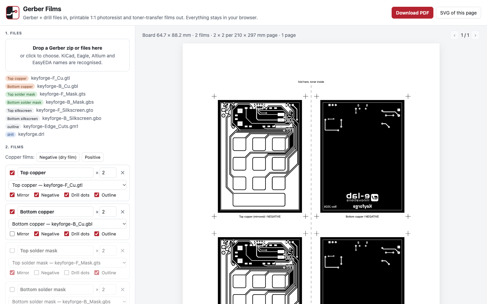

<p align="center">
  
</p>

<h1 align="center">Gerber Films</h1>

<p align="center">
  Turn PCB Gerber files into printable <b>1:1 films</b> for home PCB making:<br>
  photoresist (negative or positive), UV solder mask and toner transfer.
</p>

<p align="center">
  <a href="https://gerber-films.elabins.com"><b>Open the app</b></a> ·
  <a href="https://gerber-films.elabins.com/gerber-films.html" download>Offline single file</a> ·
  <a href="#development">Development</a>
</p>

<p align="center">
  
</p>

## Features

- **Drop in a Gerber zip** (or loose files) from KiCad, Eagle, Altium, EasyEDA and others.
  Layers are recognised from their file names.
- **Any number of films per sheet**: pick the layer, number of copies, mirror, negative,
  drill-centre dots and board outline for each one.
- **Sheet layout**: A4, A3, Letter, Legal or custom page, landscape, margins, gaps,
  columns (auto or fixed), 90° rotation, border around the board.
- **Fold pairs** for double-sided boards: top and bottom copies side by side with a fold line.
  Fold the strip toner-inside and the two layers land exactly on top of each other.
- **Registration crosses, labels and a 50 mm check bar** on every sheet.
- **Exact 1:1 PDF**: written directly as vector paths with the page size in points, so
  "Actual size" printing is true to scale. SVG export of any page too.
- **Private**: everything runs in the browser. Files are never uploaded.
- **Works offline**: download `gerber-films.html`, one self-contained file, and open it from disk.

## How to use

1. Export Gerbers and the drill file from your PCB tool (include the board outline).
2. Drop the zip into the app. You start with top and bottom copper as negative films,
   2 copies each, top mirrored. Solder mask and silkscreen films are ready but switched off.
3. Adjust films and the sheet, check the preview, then **Download PDF**.
4. Print on transparency at **Actual size / 100 %** with no scaling, and measure the 50 mm bar.

| Film | Resist / ink | Settings |
| --- | --- | --- |
| Copper, dry-film photoresist (negative) | copper prints clear, rest black | Negative on |
| Copper, positive pre-sensitized board | copper prints black | Negative off |
| UV solder mask | openings print black | Negative off, pick the mask layer |
| Toner transfer | copper prints black | Negative off |

Top-side films are mirrored so the printed side lies against the copper, which gives the
sharpest edges. If the toner is not fully opaque, print the sheet twice and stack the two films
on the registration crosses.

## Development

Requires Node.js 18 or newer.

```bash
npm install
npm run dev            # local dev server
npm run build          # static site in dist/
npm run build:single   # gerber-films.html, everything inlined
```

| File | Role |
| --- | --- |
| `src/load.ts` | unzip, identify layers, parse and plot ([tracespace](https://github.com/tracespace/tracespace)) |
| `src/geometry.ts` | plot to filled and stroked paths in mm; arcs as Béziers; pad holes by winding |
| `src/layout.ts` | films and sheet settings to pages and tile transforms (mirror, rotation, fold symmetry) |
| `src/render.ts` | negative backgrounds, drill dots, crosses, labels, fold line, scale bar |
| `src/svg.ts`, `src/pdf.ts` | SVG preview and export; a small vector PDF writer |

### Deployment

Every push to `main` builds the site and the single-file version and publishes them to
GitHub Pages (`.github/workflows/deploy.yml`) at
[gerber-films.elabins.com](https://gerber-films.elabins.com).

## Known limitations

- Clear polarity (`%LPC*%`) is not supported by the Gerber plotter used here. Files that use it
  get a warning in the layer list. KiCad does not produce it.
- `@tracespace/plotter` 5.0.0-alpha.0 builds macro vector lines with the width along the line
  instead of across it. `src/geometry.ts` repairs these; KiCad's rounded-rectangle pads rely on them.

## License

[MIT](LICENSE) © e-labInnovations
